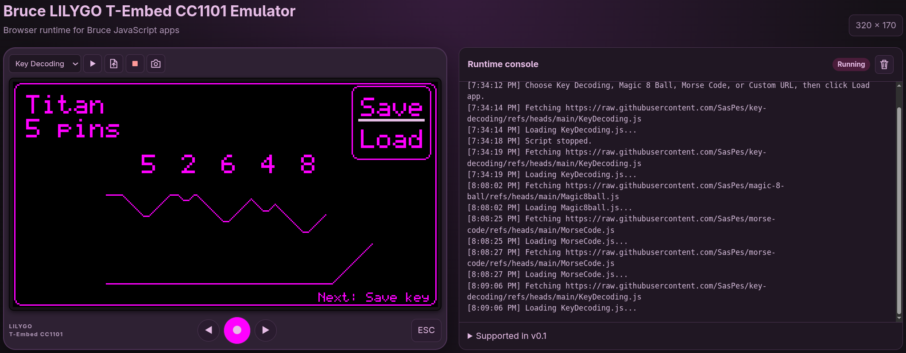

# Bruce JS Interpreter Web Emulator

A browser emulator for Bruce JavaScript apps on various devices across different screen sizes.
The device can be changed from the dropdown in the header, including a custom width and height.

**Live emulator:** [bruce-js-app-emulator.saspes.workers.dev](https://bruce-js-app-emulator.saspes.workers.dev/)



## Run

Requires **Python 3** and a modern browser. No additional packages or build step.
From the project directory:

```bash
python3 start-server.py
```

Open [localhost:8080](http://localhost:8080)

Use the included server for `SharedArrayBuffer` support. Opening `index.html`
directly or using `python3 -m http.server` will not work.

The browser UI is in `app.js`; the standalone `emulator-worker.js` is a
**classic worker**, not a module. It keeps Bruce globals and direct script
`eval` in the worker scope. `pixel-renderer.js` draws both the display and
offscreen sprites. Serve these files together from the same origin.

## Run with Docker

The `docker/` folder has a `Dockerfile` (Python slim image running `start-server.py`
as a non-root user, with a health check) and a sample `docker-compose.yml`:

```sh
cd docker
docker compose up --build
```

Then open <http://localhost:8080>. Without Compose, build from the repository root:
`docker build -f docker/Dockerfile -t bruce-js-emulator .` and run with
`docker run -p 127.0.0.1:8080:8080 bruce-js-emulator`.

The sample publishes the port on `127.0.0.1` only. The emulator needs HTTPS or
`localhost` for `SharedArrayBuffer`, and the server's `/proxy` endpoint fetches URLs
for anyone who can reach it, so put an HTTPS reverse proxy with access control in
front before exposing it. `HOST` and `PORT` environment variables change where
`start-server.py` listens (the image sets `HOST=0.0.0.0`).

## Deploy to Cloudflare Pages

The whole emulator runs in the browser and can be hosted on Cloudflare Pages'
Free plan. No Python server, Pages Functions, dependencies, or environment
variables are needed in production.

1. Push the project, including `_headers`, to GitHub.
2. In Cloudflare, open **Workers & Pages > Create application > Pages** and
   import the GitHub repository.
3. Use the following deployment settings:

| Setting | Value |
| --- | --- |
| Framework preset | None |
| Production branch | `main` |
| Root directory | Default (repository root) |
| Build command | `rm -rf dist && mkdir -p dist && cp index.html favicon.ico style.css config.js devices.js app.js emulator-worker.js pixel-renderer.js _headers dist/` |
| Build output directory | `dist` |
| Environment variables | None |

4. Select **Save and Deploy**, then open the generated HTTPS `*.pages.dev` URL.
   Subsequent pushes to `main` deploy automatically.

The build command recreates the generated `dist/` directory and copies only the
browser assets listed above, so stale assets, source documentation,
screenshots, local server, and IDE files are not published. Do not store anything
manually in `dist/`; it is ignored by Git and replaced on each build.
The `_headers` file must be in the deployment output: it sets
`Cross-Origin-Opener-Policy: same-origin` and
`Cross-Origin-Embedder-Policy: require-corp`, which enable the cross-origin
isolation required by `SharedArrayBuffer`. Cloudflare provides HTTPS.

Custom script URLs must use HTTPS and allow CORS from the deployed site.
Hosting on Pages does not bypass restrictions imposed by script hosts; download
and upload the script locally if its URL is blocked.

## Deploy to Cloudflare Workers Static Assets

The included `wrangler.toml` uses the same curated `dist/` output and declares
the same copy command under `[build]`. With Wrangler available, `wrangler dev`
or `wrangler deploy` runs that command before serving or uploading assets.
No Python server or new project dependencies are required. The worker script
and isolation `_headers` are included; the repository root is never the asset
directory. If another deployment tool skips Wrangler's build step, run the
build command from the Pages table first and publish only `dist/`.

## Static hosting without the proxy

`wifi.httpFetch` can relay requests through a `/proxy` endpoint, which only exists
with `start-server.py` or the Cloudflare Worker (`worker.js`). On a purely static
host (Cloudflare Pages as configured above, GitHub Pages, S3, ...) set the flag in
`config.js` before publishing:

```js
window.EMULATOR_CONFIG = { serverProxy: false };
```

The "HTTP: proxy" option is then hidden; "HTTP: direct" and "HTTP: Corsfix" still
work. Static hosts also need the `Cross-Origin-Opener-Policy: same-origin` and
`Cross-Origin-Embedder-Policy: require-corp` headers (see `_headers`) for
`SharedArrayBuffer`; hosts that cannot set them will not run the emulator.

## Usage

- Select **Key Decoding**, **Magic 8 Ball**, **Morse Code**, or an app under **Apps from Bruce App Store**, then click the play icon.
- Use **Custom URL** or the upload icon to load another `.js` app.
- The newest URL or file load wins; superseded fetches/file reads are cancelled
  and cannot start an older script. Read failures appear in the runtime console.
- **Stop** ends the app and cancels any pending load; the camera icon saves the
  display as a **640 x 340 PNG**.
- The runtime console retains the newest **500 entries**, up to **100,000
  characters** total; individual entries longer than **10,000 characters**
  are truncated. **Clear log** also clears the retained entries.

Presets require internet access. If CORS blocks a URL, download the script
and upload it locally.

## Controls

| Key | Action |
| --- | --- |
| Left / Up Arrow, `,`, `;` | Previous |
| Enter | Select |
| Right / Down Arrow, `/`, `.` | Next |
| Escape, Backspace, `` ` `` | Back |

On-screen buttons provide the same controls.

## Supported features

| Category | API | Support and limitations |
| --- | --- | --- |
| Display | `require("display")` | Text, shapes, colors, bitmaps, and XBitmap |
| Display | `display.getRotation()`, `display.getBrightness()` | Simulated display settings |
| Sprites | `display.createSprite()` | Offscreen drawing and push, paced at up to 30 FPS |
| Text | Display and sprite `print()` / `println()` | Independent cursor state; `print()` does not advance it, while `println()` advances only Y by `8 * textSize`. Sprites inherit display text color/size, starting at `(0, 0)` with left/top alignment. |
| Text | `setTextSize(size)`, `setTextColor(color)` | Legacy globals update the display's text state |
| Gradients | `drawFillRectGradient(x, y, width, height, firstColor, secondColor, direction)` | Display and sprite fallback uses only `firstColor` |
| Keyboard | `require("keyboard")`, `keyboard.setLongPress(enabled)`, `keyboard.getKeysPressed()` | Held-control polling (disabled by default) and held Cardputer keys |
| Input | `keyboard.keyboard(initialText, maxLength, prompt)`, `keyboard.numKeyboard()` | Browser input up to 4096 characters; numeric entry requests digits only. Prompts are not password-masked: use throwaway PINs/passwords only. |
| Dialogs | `require("dialog")` | Choice menus, blocking messages, info/success/error messages, and virtual file picker |
| Dialogs | `dialog.prompt(title, maxLength, initialText)` | Browser text input |
| Text viewer | `dialog.createTextViewer(text, options)` | Wrapping; `setText`, `clear`, `draw`, `scrollUp`, `scrollDown`, `scrollToLine`, `getLine`, `getMaxLines`, `getVisibleText`, `close`. Options: `fontSize`, `startX`, `startY`, `width`, `height`, `indentWrappedLines`. |
| Serial | `require("serial")` | Console print/println, timeout-only `readln(timeoutMs = 10000)`, and `cmd("storage remove <path>")`. Other commands log a warning and return `false`. |
| Audio | `require("audio")` | Tone playback and stop |
| Device | `require("device")` | Simulated name, board, model, Bruce version, battery, heap, and EEPROM information |
| Battery | `require("battery")`, `battery.level()` | Same simulated 100% reading as `device.getBattery()` |
| GPIO | `require("gpio")`, `gpio.analogWrite(pin, value)` | Pins 0-48, PWM values 0-255; changed values logged only, no physical output. Other GPIO methods unsupported. |
| Wi-Fi | `require("wifi")` | Simulated station: the network chosen in the header dropdown is the one the device is connected to (`connected()` is `true`, `getIPAddress()` returns `192.168.1.100`; "none" means disconnected). `connect(ssid, ...)` and `disconnect()` change that selection, `connectDialog()` succeeds when a network is selected, `scan()` lists the dropdown networks. `httpFetch(url, {method, headers, body})` sends a real synchronous request and returns `{status, ok, body, headers}`. The "HTTP" header dropdown picks **direct** (browser request, subject to CORS), **proxy** (relayed through the server's `/proxy`, no CORS limit) or **Corsfix** (the free public [Corsfix](https://corsfix.com/free-cors-proxy) CORS proxy; no server needed, but its free tier is rate limited and, on a deployed site rather than localhost, needs the Corsfix SDK or a registered domain). A failed request returns `status` 0. |
| IR | `require("ir")`, `transmit(data, protocol = "NEC", bits = 32)` | Hexadecimal transmissions logged only, returning `true`; no physical signal. `read(timeoutSeconds = 10)` / `readRaw(timeoutSeconds = 10)` return empty strings after timeout with a one-time notice. File transmission unsupported. |
| BadUSB | `require("badusb")` | Simulated `setup`, `print`, `println`, `press`, `pressRaw`, `hold`, `release`, `releaseAll`; call `setup()` first. Logged only, no USB device or host keystrokes. `runFile` logs and returns `false`. |
| Sub-GHz | `require("subghz")`, `setFrequency(MHz)`, `transmit(hexData, frequencyHz = 433920000, te = 174, count = 10)` | Transmissions logged only, returning `true`. Default transmit frequency is independent of `setFrequency`, which validates/logs tuning only. `read` / `readRaw` return empty strings after timeout (seconds, default 10) with a one-time notice. `transmitFile` logs and returns `false`. |
| Storage | `require("storage")` | In-memory files, `readdir` (including `withFileTypes`), and space information. String paths or `{fs: "sd" \| "littlefs", path: "/file"}`; files are kept in this browser (localStorage, text only) and can be viewed, edited, uploaded, downloaded and deleted in the **Storage** panel. Edits made in the panel while an app runs are seen the next time it loads. |
| Timing | `delay(ms)`, `now()` | Blocking Bruce-style polling loops |
| Random | `random()`, `random(max)`, `random(min, max)` | Integers; upper bound exclusive |
| Garbage collection | `gc()` | Logs once that browser collection is automatic and cannot be forced |
| Script paths | `__dirpath`, `__filepath` | Virtual `/scripts` directory and loaded filename (URL filenames decoded); no host filesystem access |
| CommonJS | `exports`, `module.exports` | Compiled script compatibility; `require()` resolves supported Bruce modules only |
| Conversion | `to_string(value)`, `parse_int(value)` | Firmware-style numeric conversion, not JavaScript's `parseInt` |
| Logging | `print()`, `println()` | Runtime console output |
